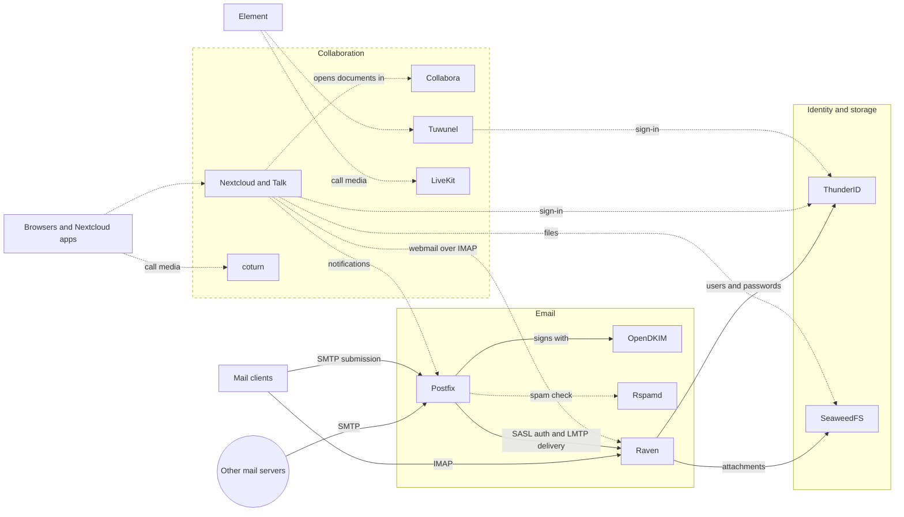

# Architecture

OpenGovMail is a set of open source services, installed together by the Helm chart in [charts/opengovmail](../charts/opengovmail). Email and identity are always on. The [collaboration](Collaboration.md) services are optional, shown dashed below.

How mail moves:

- Incoming mail reaches Postfix, which checks it with Rspamd when that's enabled and hands it to Raven over LMTP. Raven stores each user's mailbox in its own SQLite database and keeps attachments in SeaweedFS.
- Outgoing mail is submitted to Postfix, which asks Raven to check the password (SASL), signs the message with OpenDKIM, and sends it.
- Mail clients read mail from Raven over IMAP.
- Raven looks up users, groups and domains in ThunderID. Each ThunderID organization unit owns one or more mail domains.

The email flow figures in the [README](../README.md#email-flow-in-opengovmail) show the same paths in more detail.

## Stack

Versions are the ones chart 0.6.1 ships. [CHANGELOG.md](../CHANGELOG.md) lists what changed in each release.

| Component | Version | Role | Install |
|---|---|---|---|
| [Postfix](https://www.postfix.org/) | image 0.6.1 | Sends and receives mail | Helm and Compose |
| [OpenDKIM](http://www.opendkim.org/) | image 0.6.1 | Signs outgoing mail | Helm and Compose |
| [Raven](https://github.com/OpenGovMail/raven) | 0.9.1 | IMAP, LMTP delivery and SASL authentication | Helm and Compose |
| [ThunderID](https://github.com/thunder-id/thunderid) | 1.0.2 | Users, groups, organization units and sign-in | Helm and Compose |
| [SeaweedFS](https://github.com/seaweedfs/seaweedfs) | 4.51 | S3 object storage for attachments and files | Helm and Compose |
| [Rspamd](https://rspamd.com/) | 4.1.1 | Spam filtering | Compose; optional in Helm (`rspamd.enabled`) |
| [Redis](https://redis.io/) | 7 | Rspamd's storage | Compose; optional in Helm (`redis.enabled`) |
| [Unbound](https://nlnetlabs.nl/projects/unbound/) | latest | DNS resolver for Rspamd's blocklist lookups | Compose; optional in Helm (`unbound.enabled`) |
| [ClamAV](https://www.clamav.net/) | | Malware scanning | Compose only |
| [Prometheus](https://prometheus.io/), [Grafana](https://grafana.com/) and [Loki](https://grafana.com/oss/loki/) | | Metrics, dashboards and logs | Compose only |
| [cert-manager](https://cert-manager.io/) | 1.20.0 | Let's Encrypt certificates | Helm, installed once per cluster |
| [Certbot](https://certbot.eff.org/) | | Let's Encrypt certificates | Compose only |

The collaboration components and their versions are in [Collaboration.md](Collaboration.md#components).

## Source

| Repository | What it holds |
|---|---|
| [OpenGovMail/OpenGovMail](https://github.com/OpenGovMail/OpenGovMail) | The Helm chart, the Docker Compose setup, and the Postfix and OpenDKIM images |
| [OpenGovMail/raven](https://github.com/OpenGovMail/raven) | Raven, written in Go |
