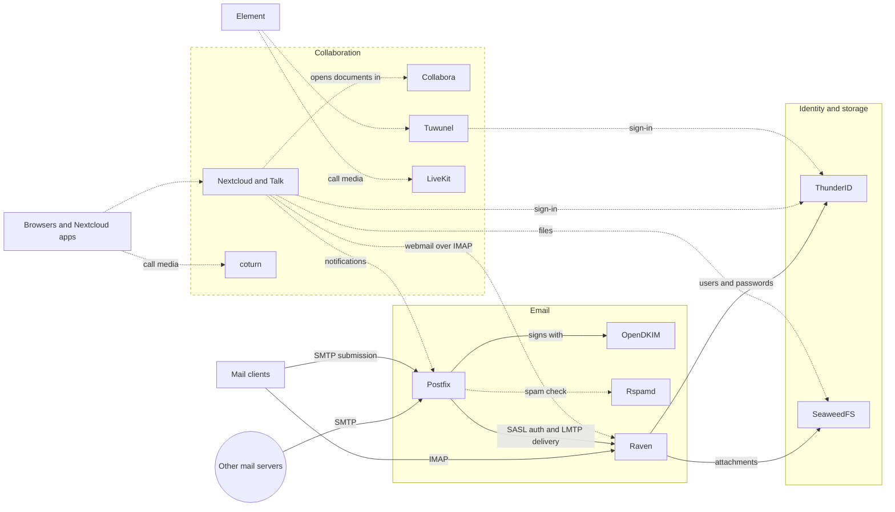

# Overview of the architecture

OpenGovMail is a set of open source services that one Helm chart, [charts/opengovmail](../../charts/opengovmail), installs together on Kubernetes. Email and identity are always on. The collaboration services are optional and shown dashed below. This page explains how the parts connect and how mail moves between them. [Technology stack](../reference/technology-stack.md) lists each component's version.

## Background

OpenGovMail is built from existing open source servers rather than written from scratch. Postfix handles SMTP, the protocol mail servers use to pass mail to each other. Raven, written for this project, stores mailboxes and serves them to mail clients over IMAP. ThunderID holds the accounts, so every service checks the same user name and password, and an email address and an account are the same thing.

On Kubernetes, each service runs in its own pod. cert-manager gets Let's Encrypt certificates for every hostname, and Traefik, the ingress controller in k3s, routes web traffic to the right service. Postfix and Raven bind their mail ports directly on the node, so they see each client's real IP address, which spam scoring needs.

## How mail moves

<table>
<tr>
<td width="50%">

Figure 1: Outbound email flow

</td>
<td width="50%">

Figure 2: Inbound email flow

</td>
</tr>
</table>

- Incoming mail reaches Postfix, which checks it with Rspamd when that's turned on and hands it to Raven over LMTP. Raven stores each user's mailbox in its own SQLite database and keeps attachments in SeaweedFS.
- Outgoing mail is submitted to Postfix, which asks Raven to check the password (SASL), signs the message with OpenDKIM, and sends it.
- Mail clients read mail from Raven over IMAP.
- Raven looks up users, groups and domains in ThunderID. Each ThunderID organization unit owns one or more mail domains. [Identity and users](identity-and-users.md) explains this.

## Use cases

- An organization running mail only installs the chart with its defaults: Postfix, OpenDKIM, Raven, ThunderID and SeaweedFS.
- An organization that wants spam filtering turns on Rspamd, with Redis for its storage and Unbound as its DNS resolver.
- An organization that wants calendars, files, document editing and meetings turns on Nextcloud, which brings Collabora and Talk. Chat adds Tuwunel, a Matrix server, and LiveKit for its calls. All of them sign users in through ThunderID. See [Add the collaboration services](../how-to/enable-collaboration.md).
- An organization that already runs ThunderID points the chart at it with `global.thunder.url` instead of installing the bundled one.

## Source

| Repository | What it holds |
|---|---|
| [OpenGovMail/OpenGovMail](https://github.com/OpenGovMail/OpenGovMail) | The Helm chart, and the Postfix and OpenDKIM images |
| [OpenGovMail/raven](https://github.com/OpenGovMail/raven) | Raven, written in Go |

## Related resources

- [Technology stack](../reference/technology-stack.md)
- [Hostnames and ports](../reference/hostnames-and-ports.md)
- [Identity and users](identity-and-users.md)
