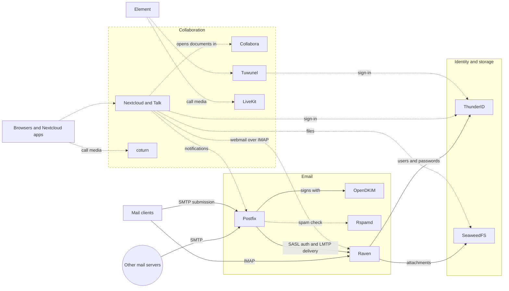

# Overview of the architecture

OpenGovMail is a set of open source services. One Helm chart, [charts/opengovmail](../../charts/opengovmail), installs them together on Kubernetes. Email and identity are always on. The collaboration services are optional. The diagram shows them with dashed lines. This page tells you how the parts connect and how mail moves between them. The [technology stack](../reference/technology-stack.md) gives the version of each component.

## Background

Most parts of OpenGovMail are open source servers that existed before the project. Postfix operates SMTP. SMTP is the protocol that mail servers use to send mail to each other. Raven is new for this project. It keeps the mailboxes and supplies them to mail apps through IMAP. ThunderID keeps the accounts. Thus, all the services use the same username and password, and an email address and an account are the same.

On Kubernetes, each service operates in its own pod. cert-manager gets Let's Encrypt certificates for each hostname. Traefik is the ingress controller in k3s. It sends web traffic to the correct service. Postfix and Raven use their mail ports directly on the node. Thus, they see the real IP address of each client. Spam filters must have this address.

## How mail moves

<table>
<tr>
<td width="50%">

Figure 1: Outbound email flow

</td>
<td width="50%">

Figure 2: Inbound email flow

</td>
</tr>
</table>

- Incoming mail goes to Postfix. If Rspamd is on, Postfix sends the mail to Rspamd for a spam check. Then Postfix gives the mail to Raven through LMTP. Raven keeps the mailbox of each user in a separate SQLite database. It keeps attachments in SeaweedFS.
- Mail apps send outgoing mail to Postfix. Postfix asks Raven to examine the password (SASL). Then OpenDKIM signs the message, and Postfix sends it.
- Mail apps read mail from Raven through IMAP.
- Raven gets the users, groups and domains from ThunderID. Each ThunderID organization unit has one or more mail domains. [Identity and users](identity-and-users.md) tells you more.

## Use cases

- An organization with only mail installs the chart with its default values. These install Postfix, OpenDKIM, Raven, ThunderID and SeaweedFS.
- For spam filtering, an organization adds Rspamd. Rspamd uses Redis to keep its data and Unbound as its DNS resolver.
- For calendars, files, document editing and meetings, an organization adds Nextcloud. Nextcloud brings Collabora and Talk. For chat, the organization adds Tuwunel, a Matrix server, and LiveKit for calls. All these services sign users in through ThunderID. Read [Add the collaboration services](../how-to/enable-collaboration.md).
- An organization that has a ThunderID already sets `global.thunder.url` to it. Then the chart does not install a second ThunderID.

## Source

| Repository | What it holds |
|---|---|
| [OpenGovMail/OpenGovMail](https://github.com/OpenGovMail/OpenGovMail) | The Helm chart, and the Postfix and OpenDKIM images |
| [OpenGovMail/raven](https://github.com/OpenGovMail/raven) | Raven, written in Go |

## Related resources

- [Technology stack](../reference/technology-stack.md)
- [Hostnames and ports](../reference/hostnames-and-ports.md)
- [Identity and users](identity-and-users.md)
